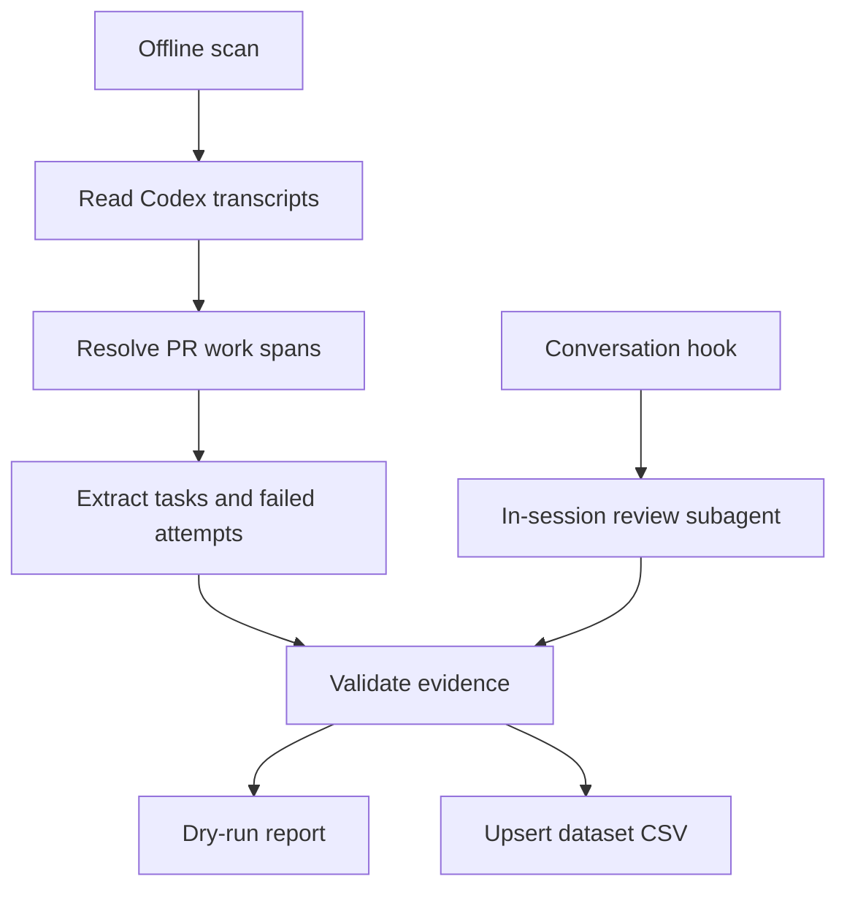
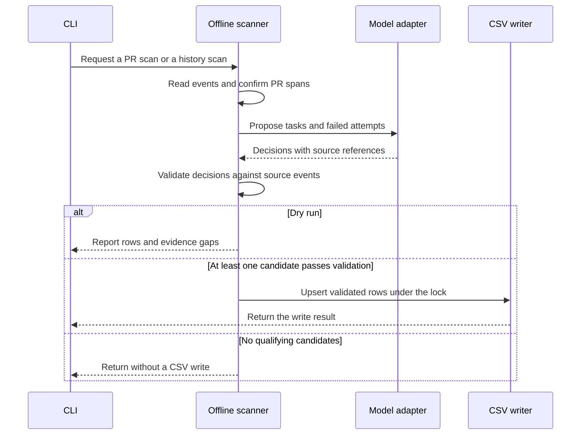
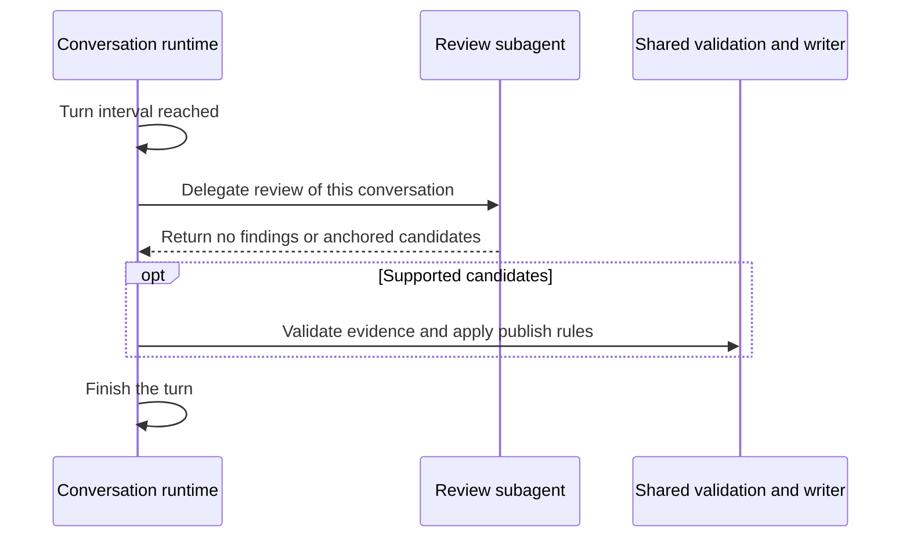

# Agent History Dataset Builder implementation plan

## Overview

Build a local dataset of failed Codex attempts linked to GitHub pull requests (PRs). An attempt can be an implementation or a design decision. Each row preserves the original user prompt, the failure reason, and references to the evidence.

The offline scanner reads saved sessions. The online hook requests a review by a subagent in the active conversation. Both paths use the same evidence checks and CSV writer. Start with a dry run against one confirmed PR.



### Critical user journeys

| ID | User journey | Pass condition |
|---|---|---|
| **CUJ 1** | **Preview one PR.** I run a dry scan for a PR where I corrected Codex. | The report shows the matched sessions, turn ranges, and match reasons. It finds the known miss and shows the original prompt and evidence. The CSV stays untouched. |
| **CUJ 2** | **Backfill my history.** I run the scanner without a PR URL. | The scanner finds PRs from transcript evidence. A conversation that switches PRs produces rows under the correct PRs. Ambiguous spans appear in the report. Two corrections to one attempt yield one row. |
| **CUJ 3** | **Verify a row.** I follow its evidence references and mark the attempt verified. | The source events show the original request, what Codex did, and what went wrong. A later scan preserves the verified row. |
| **CUJ 4** | **Capture a failure while I work.** I correct Codex and continue the conversation. A child reviewer runs at the configured turn interval. | A supported failure appears once in the configured CSV without a manual scan. Subagent work does not advance the root turn count. |
| **CUJ 5** | **Capture a failure before compaction.** Deferred on the stock Codex client. | A future runtime integration must let a child review the original context before manual and automatic compaction. |
| **CUJ 6** | **Leave clean sessions alone.** A review runs after clarification, new requirements, or routine retries. It finds no supported failure. | An existing CSV stays untouched. If the CSV is absent, the review creates no file. |
| **CUJ 7** | **Recover and rerun safely.** I open a PR later, miss a review, or rerun an offline scan after online capture. | The later scan recovers a supported failure when the PR link and evidence are available. Replay reuses any existing attempt ID and adds no duplicate row. |

## Design Constraints

- The CSV is the only persistent output. Read existing rows for published IDs and reviewer decisions. Keep candidate tasks, pending findings, and replay context in memory. The next scan can rebuild them from the source transcripts.
- Scripts own input discovery, PR matching, context selection, source validation, and CSV writes. The LLM decides task boundaries and whether the evidence supports a failure label.
- The caller supplies the history roots and selects a CSV path for writes. Paths can differ across machines. Derive IDs and source anchors from transcript and PR identifiers. Keep local paths out of those identifiers.
- A PR association covers a work span. One thread can switch between PRs. A branch name, base commit, or PR mention alone cannot confirm a match.
- Preserve the exact initiating prompt, including whitespace and line breaks. Keep source references for attachments and tool results. Report known truncation or missing evidence.
- Publish a row when the evidence supports the failure and its PR link. Report uncertain cases in dry-run output. A later scan can retry them with more evidence.
- Both entry points use the same validation and write path. Repeated runs preserve verified rows, the first-write time, and the first-write repository snapshot.
- Start with Python and a local CSV. Use a stable lock during writes and verification. Hold it while reading the latest CSV, resolving IDs, and replacing the file.

## Running instructions

Set `CODEX_HISTORY_ROOT` and `OUTPUT_CSV` to paths on the machine that runs the command.

```bash
# Preview one confirmed PR.
scan-history --codex-home "$CODEX_HISTORY_ROOT" --pr "$PR_URL" --dry-run

# Publish rows for that PR.
scan-history --codex-home "$CODEX_HISTORY_ROOT" --pr "$PR_URL" --output "$OUTPUT_CSV"

# Backfill discoverable history after the one-PR scan passes.
scan-history --codex-home "$CODEX_HISTORY_ROOT" --output "$OUTPUT_CSV"

# Mark a reviewed row as verified.
verify-attempt --output "$OUTPUT_CSV" "$ATTEMPT_ID"
```

Repeat `--codex-home` to include copied Codex history roots from other machines. Resolve relative CLI paths from the caller's working directory. `--since UTC` filters candidates by correction time after history has been read. It has no read-selection or model-call budgeting effect.

Publishing and verification require an explicit `--output`. A dry run can omit it. Supply it during a dry run to check proposed rows against an existing CSV. The report shows session IDs, matched turn ranges, match reasons, proposed tasks and rows, and evidence gaps. It makes no writes.

### Enable the online hook

Generate a conversation review hook with `dataset-review-hook config --output "$OUTPUT_CSV" --every 5`. Merge the generated `UserPromptSubmit` and `SubagentStop` entries into `.codex/hooks.json`. Trust both hooks in Codex. Set `--every` to a positive integer. The default is `5`.

Set the hook's CSV path explicitly on each machine. To share a CSV with the offline CLI, point both at the same file. Resolve the configured path before the hook runs so a conversation's working directory cannot change the destination. The [publish rules](#publish-rules) control whether a review changes the CSV.

A trusted `PreCompact` command ran during the manual compaction probe. It could not start a child in that conversation. The stock app-server schema also exposed no request to start a native child at that boundary. See the [Codex hook reference](https://developers.openai.com/codex/hooks).





## Output dataset schema

Keep the current failure labels and CSV columns stable. Version future taxonomy or schema changes and document compatibility before writing the new format.

Use UTF-8 CSV with standard quoting. Each row represents one failed attempt. Multiple corrections to that attempt can support the same row.

| Columns | Contents |
|---|---|
| `attempt_id`, `task_id` | Stable identifiers for the attempt and task. |
| `pr_url`, `pr_link_evidence` | The PR URL and the source evidence that links the work span to it. |
| `task_description`, `original_prompt` | The requested change, key constraints, expected behavior, and the exact initiating user message. |
| `task_started_at`, `task_ended_at` | The task bounds in UTC. Leave the end blank while the task is open or its end is unclear. |
| `attempt_summary`, `attempt_started_at`, `attempt_ended_at` | The original approach, its observed or reported outcome, and its UTC bounds. |
| `detection_trigger`, `correction_summary`, `correction_started_at`, `correction_ended_at` | The feedback or acknowledgment and its UTC bounds. The trigger is `user_correction` or `agent_self_correction`. |
| `failure_label`, `failure_reason` | The primary label and a short explanation of the missed requirement. |
| `evidence_refs` | A JSON array in one CSV cell. Each reference includes its role, source session ID, and event anchor. Include the request, the attempt, and evidence of the failure. Include rules, context, and attachment references when relevant. |
| `attempt_head_sha`, `recorded_head_sha`, `recorded_worktree_dirty` | The observed commit at attempt time and the original worktree state at first write. Leave unavailable values blank. |
| `created_at`, `human_verified` | The first-write time in UTC and the review flag. Set the flag to `false` for a new row. |
| `codex_thread_id`, `codex_thread_url` | The implementation's stored Codex thread ID and its Desktop link when the ID is a UUID. |

| Failure label | Evidence required |
|---|---|
| `known_rules_violation` | The attempt broke an explicit rule that applied. |
| `code_smell_precedent` | The attempt followed or extended a problematic pattern already present. |
| `code_smell_invented` | The attempt introduced a problematic pattern. |
| `incorrect_design_decision` | The design failed under the known requirements and facts. |
| `missing_local_repo_context` | A repository fact would have changed the attempt. For example, the agent missed an existing helper. |
| `missing_cross_system_dependency_knowledge` | A fact about another system or dependency would have changed the attempt. |

### Publish rules

Require a confirmed PR, a task request, and evidence of an implementation or design decision. Require a supported label and evidence that the attempt missed a requirement that applied at the time. Use either trigger below.

| Trigger | Evidence required |
|---|---|
| `user_correction` | The user points to a miss in the attempt. The source evidence shows that the requirement already applied. |
| `agent_self_correction` | The agent acknowledges a miss. A separate record supports it, such as a diff, failed verification, or revert. |

A routine retry, a clarification, or a new requirement alone adds no row. An unresolved PR or missing evidence also adds no row.

Under the write lock, compare validated candidates with the latest CSV. Add a distinct, supported failure once. Update an unverified row only if the candidate adds evidence that supports the requirement, the attempt, or the failure. Preserve verified rows. If nothing qualifies for insertion or update, leave the CSV untouched. If the CSV does not exist, leave it absent.

### Row identity and replay

Derive a new task ID from the canonical PR, the initiating message anchor, and the outcome quote's UTF-8 byte offset. Separate outcomes in one message can share `original_prompt` and have different task IDs.

Derive a new attempt ID from the canonical PR and the earliest supported implementation or design anchor. Use accepted implementation anchors in `evidence_refs` to match new evidence to existing rows. If a scan finds earlier evidence for a matched attempt, reuse its ID.

A shared file path or overlapping time range can suggest a match. Require supporting evidence before merging. If competing anchors could describe one attempt, report the conflict and defer the new row.

Use recorded event IDs for ordinary rollout anchors. If one is absent, use the logical rollout ID and record position. For paginated history, derive a page ID from the recorded page prefix and retain the original record position. Join available pages for the same session when their recorded time ranges establish order. A copied transcript resolves the same anchors at a new path. Recorded worktree paths are lookup hints. If the original worktree cannot be identified locally, leave its snapshot fields blank.

Page-aware readers can generate different task and attempt IDs for the same paginated history. This happens when the source anchors change. There is no migration from the old IDs. A replay may add a row under the new ID when the two anchor sets cannot be matched. The writer preserves the values of existing human-verified rows.

## Implementation Steps

Each task lists the scripting work and any LLM judgment. Use fixtures at component boundaries so a task can be verified before the full pipeline exists.

Run the [CUJ acceptance checks](#cuj-acceptance-checks) when each entry point is ready. The component tests and the applicable CUJ checks must pass before that part of the implementation is complete.

### 1. Read transcripts and resolve PRs

| Task | Scripting | LLM | Independent verification |
|---|---|---|---|
| **1A. Normalize transcripts** | Read plain and Zstandard JSONL from the supplied roots. Preserve anchored messages, steering, tool results, and known gaps. Pair calls and results by call ID. | None. | Move a rollout and read both file formats. Compare anchors and event order. Complete a partial record and verify that it is emitted once. |
| **1B. Resolve PR work spans** | For `--pr`, fetch the PR and match successful publication results or confirmed commit SHAs against local events. For a backfill, look up PR candidates from transcript evidence. Keep evidence together across worktree paths when recorded repository and branch evidence agree. Require a known worktree repository for commit matches. | None. | Match a known PR to two sessions. Verify the session IDs, turn ranges, and match reasons. Reject a bare PR mention, ambiguous publication, and a reused branch alone. |

### 2. Extract tasks and detect failures

| Task | Scripting | LLM | Independent verification |
|---|---|---|---|
| **2A. Build candidate windows** | Start a block at each genuine user message, including mid-turn steering. End it before the next user message or at the span boundary. Include the previous block. Retrieve prior tasks by direct reference, exact shared artifact, then recency. | None. | Check block membership and retrieval order with fixture events. Verify that `--since` retains a relevant earlier request. |
| **2B. Extract task decisions** | Send anchored blocks to the model. Check that the quoted outcome appears uniquely in the initiating user message. Copy the full prompt and derive timestamps and IDs from the source. | Decide whether to open, continue, revise, or close a task. Split independent outcomes. Keep corrections and constraints with the task they support. | Script a two-outcome response and verify two IDs and one verbatim prompt. Reject an invented quote. Measure false splits and merges on a hand-labeled PR. |
| **2C. Label failed attempts** | Check source anchors, event roles and order, allowed labels, and required evidence fields. For self-correction, require an acknowledgment and a separate source record. | Group events into attempts. Decide whether the attempt missed a requirement that applied at the time. Choose a label and cite the evidence, or return no finding. | Reject missing or invalid evidence with scripted responses. On the hand-labeled PR, check that two corrections to one attempt yield one row. Check that a routine retry or new requirement alone yields none. |

### 3. Publish rows and run the offline scan

| Task | Scripting | LLM | Independent verification |
|---|---|---|---|
| **3A. Write and verify rows** | Lock and read the caller-selected CSV. Reuse IDs supported by existing evidence. Replace the CSV atomically only when a row changes. Use the same lock for review updates. | None. | Test multiline prompts, concurrent writes, and interrupted writes. Verify that replay leaves duplicates and verified rows untouched. |
| **3B. Run the one-PR scan** | Wire the components into the CLI. Require an output path for publishing. Print the report in dry-run mode. Add all-history discovery after the one-PR scan works. | None beyond the analysis in 2B and 2C. | Run from two working directories using copied history and different output paths. Verify identical row IDs and no writes outside the selected output. |

### 4. Add the online hook

#### Review triggers

| Trigger | When to delegate |
|---|---|
| Turn cadence | At each multiple of `--every`, request review before the final answer of that root turn. Count completed user-driven root turns plus the incoming turn. Exclude subagent work and hook-generated continuations. |

Scope each review to the root conversation ID and triggering turn. Include earlier requests and attempts so the reviewer can connect follow-up evidence. Reuse attempt IDs during replay through the shared writer.

#### Review and publish

1. Start a read-only reviewer as a child of the active conversation. Give it the review boundary and access to the source events for that conversation.
2. Ask for `no_findings` or a list of candidate failures with source anchors. Ask the reviewer to distinguish a missed requirement from a new request or routine retry.
3. If the result is `no_findings`, finish the review without opening the CSV writer. If the result contains candidates, use the shared PR resolver and evidence checks.
4. Publish only candidates that pass the shared publish rules. Leave unsupported or unresolved findings for a later review or offline backfill.

#### Codex integration

Use `UserPromptSubmit` to pass scoped evidence and a delegation instruction to the parent on due turns. Include the incoming user prompt. Resolve it to the recorded source anchor before publishing. The parent asks a native child to review the evidence near the end of the turn. Use `SubagentStop` to validate and publish the child's result. The reviewer needs no shell access.

Strict pre-compaction delegation requires Codex runtime integration. Exclude it from this implementation. Periodic review and offline backfill remain available to recover supported evidence.

| Task | Scripting | LLM | Independent verification |
|---|---|---|---|
| **4A. Compute review triggers** | Validate `--every` and select review boundaries by root conversation ID and turn count. Exclude review work from cadence. | None. | Check the default and custom intervals. Reject zero and negative values. Verify that a continuation cannot request another review. |
| **4B. Review and publish** | Pass scoped evidence to the reviewer. Validate the result and apply the shared PR and CSV rules. Use the configured output path. | Review the active conversation for failures worth saving. Return anchored candidates or `no_findings`. | Stub the reviewer. Verify that `no_findings` never calls the writer. Verify that a supported candidate writes one row and replay preserves its ID. |
| **4C. Verify native delegation** | Deliver developer context from `UserPromptSubmit` and receive the result through `SubagentStop`. | The main agent starts the child reviewer on a due turn and passes the review package. | Observe the child in the active thread. Check that its result reaches the shared validator and writer. |
| **4D. Probe pre-compaction review** | Check whether the stock client can delegate at the compaction boundary. | None. | Verify command delivery and check for a supported native delegation path. Exclude this trigger if the path is unavailable. |

## Testing Strategy

| Level | Method | Pass criteria |
|---|---|---|
| **Unit tests** | Use small transcript fixtures and scripted GitHub and model responses. | Assert exact anchors, candidate windows, PR match reasons, reference checks, and ID reuse. Keep network calls out of these tests. |
| **Pipeline tests** | Run the fixture CLI and reviewer result handler with a temporary CSV. Test reruns, concurrent writes, and interrupted writes. | Verify row counts, prompt round trips, verified-row preservation, and recovery from the original transcript. |
| **Portability** | Copy the history and CSV to a different directory. Use different checkout and output paths, including paths with spaces. Run the CLI and hook from different working directories. | Resolve the same evidence references and reuse row IDs. Write only to the explicitly selected CSV. Report unavailable worktree snapshots without dropping supported rows. |
| **One-PR evaluation** | Hand-label task starts, continuations, and known failures before running the real model. Include a correction, a scope clarification, and a routine retry. | Report which labeled events reached the model. Count missed starts, false splits, false merges, and missing or extra failure rows. Inspect the evidence for disputed cases. |
| **Replay and client checks** | Replay the same evidence offline and through the reviewer result handler. Test the turn trigger on the target client. | Confirm ID reuse and offline recovery after a missed review. Verify that review work cannot trigger another review. |

Use the one-PR evaluation to tune retrieval and model decisions. Use the fixture tests to enforce the rules that code controls.

### Reproduce a private one-PR audit

Run this procedure on the machine with the audit material. Select the editable install's Python, version 3.10 or newer. In `DATASET_CONFIG`, enable the publication adapter used by the audit. Keep the audit inputs and outputs on the validation machine. Use that machine's GitHub and Codex credentials.

Before running the scan, check the two source symlink targets against the paths, sizes, and SHA-256 hashes in `source-files.json`. Use the complete source files. `TRACE_MODEL_COMMAND` should invoke `trace-model.py`, which records requests and responses while calling the real `StructuredModel`. A model-disabled probe cannot validate extraction.

```bash
"$DATASET_PYTHON" -m unittest discover -s tests -v
git diff --check
scan-history --config "$DATASET_CONFIG" --codex-home "$AUDIT_HISTORY_ROOT" --pr "$PR_URL" \
  --output "$AUDIT_CSV" --model-command "$TRACE_MODEL_COMMAND"
"$DATASET_PYTHON" "$AUDIT_SCRIPT" "$AUDIT_CSV"
```

Use a new output path for reproduction. Compare the original prompt, the exact requirement quote, the implementation and correction anchors, event order, and PR evidence. The expected positive is labeled `incorrect_design_decision` with `human_verified=false`. Model wording and additional candidates can vary. Keep traces, source paths, audit reports, and CSVs local.

The other checkout reported 28 passing tests, two published rows, and zero conflicts for one PR and two genuine history pages. Its report retained 144 source-output truncation gaps. The audited positive had complete publication evidence. That run did not exercise full backfill or hook deployment.

### Separate configuration proposals

- Consider config defaults for history roots, session or project selection, and explicit scan or model-call budgets. Keep `--since` documented as a result filter until read selection is implemented.
- Consider authorized GitHub Enterprise hosts, per-host authenticated API command arguments, and verified repository aliases. Use the same settings for offline scans and hooks. Keep the default GitHub.com and `gh` behavior. Enterprise profiles can be added separately.

### CUJ acceptance checks

Run the checks through the CLI and Codex entry points. Automate assertions on scanner output and CSV contents. Use the installed Codex client to verify child delegation.

| CUJ | When to verify | Test to run |
|---|---|---|
| **1. Preview one PR** | Offline CLI | Run `scan-history --pr` in dry-run mode on a hand-labeled PR. Check the session IDs, spans, known miss, and verbatim prompt. Compare the CSV state before and after. |
| **2. Backfill history** | Offline CLI | Run without `--pr` on a fixture with two PRs, a branch switch, an ambiguous span, and two corrections to one attempt. Check the PR on each row, the unresolved report entry, and the final row count. |
| **3. Verify a row** | Offline CLI | Use the evidence references to locate the source records. Run `verify-attempt`, then rerun the scan. Assert that the attempt ID and verified row are preserved. |
| **4. Capture during work** | Online turn review | On the target client, configure a three-turn interval and make a known correction. Observe a child review at turn three of the root conversation. Check that one row appears without an offline scan. |
| **5. Capture before compaction** | Deferred on stock Codex | The trusted command fired on manual compaction. Its output could not direct Codex to spawn a native child. Exclude this CUJ from the stock-client exit criteria. |
| **6. Leave clean sessions alone** | Online review | Run a due review with a clarification, new requirement, and routine retry. Verify `no_findings`. Test with no output file and with an existing CSV. Compare the existing file's contents and modification time. |
| **7. Recover and rerun** | Offline and online replay | Skip a review or make the PR link unavailable for the first pass. Backfill after the link is available. Then replay evidence already saved by the online reviewer. Check recovery, stable attempt IDs, and the absence of duplicates. |

Record the observed result and supporting evidence for each applicable CUJ in the implementation summary. Report a blocked check as blocked. CUJ 5 is deferred due to the stock client's delegation limit.

### Verification results

| CUJ | Observed result |
|---|---|
| 1 | The real GitHub and model adapters found one known failure in a controlled transcript. The dry run created no CSV. A scan of the approved historical transcript confirmed one PR span and returned no supported failures. |
| 2 and 3 | The CLI acceptance tests placed attempts under the correct PRs. Verification survived a rescan after the history moved. |
| 4 | The installed Codex client started one child on turn three. `SubagentStop` published one row with the known request, implementation, and correction from the fixture. No offline scan ran. |
| 5 | Deferred as agreed. A trusted `PreCompact` command ran on the stock client. The probe found no supported way for it to start an in-session child. |
| 6 | Native reviews returned `no_findings`. The checks confirmed that an absent CSV stayed absent and an existing CSV retained its bytes and modification time. |
| 7 | The replay fixture recovered a failure after the PR became available. The online result matched the offline attempt ID and left one row. |
